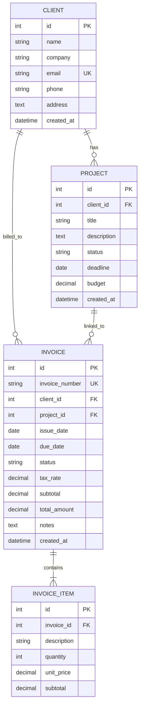

# 💼 ClientTrack — Client, Project & Invoice Management System

[](https://www.python.org/)
[](https://flask.palletsprojects.com/)
[](https://www.sqlalchemy.org/)
[](https://www.mysql.com/)
[](https://getbootstrap.com/)
[](LICENSE)

A streamlined, modern web application designed for freelancers, agencies, and small businesses to manage clients, track project lifecycles, and generate professional, print-ready invoices with live dynamic calculation.

---

## 📸 Overview & Key Features

### 📊 Executive Dashboard
- **Real-Time KPIs**: Instant metrics showing Active Clients, Ongoing Projects, Pending Invoice Value, and Collected Payments.
- **Overdue Alert System**: Proactive banners highlighting unpaid invoices past their due date.
- **Recent Activity Feeds**: Quick-glance tables for the latest projects and recently issued invoices.

### 👥 Client Management (Mini-CRM)
- Full **CRUD** (Create, Read, Update, Delete) capability.
- **Real-time client-side search** by name, company, or email address.
- Linked project and invoice tracking with cascade management.

### 📁 Project Lifecycle Tracking
- Multi-stage status workflow: `Not Started` ➔ `In Progress` ➔ `Under Review` ➔ `Completed`.
- Budget allocation, deadline tracking, and client association.
- One-click status badge filters for project organization.

### 🧾 Invoice Engine & Dynamic Billing
- **Auto-Generated Invoice Numbers**: Standardized formatting (`INV-YYYYMMDD-XXXX`).
- **Interactive Line Items**: Real-time JavaScript line-item builder with dynamic row additions, removal, and live subtotal/tax/grand-total calculation.
- **Print & PDF Ready**: Dedicated `@media print` stylesheet that strips navigation and formats the invoice into a crisp, professional A4 printout or downloadable PDF.
- **Payment Workflow**: Status lifecycle management (`Draft`, `Unpaid`, `Paid`, `Overdue`) with a single-click "Mark as Paid" action.

---

## 🛠️ Tech Stack

- **Backend**: Python 3.9+, [Flask 3.0](https://flask.palletsprojects.com/)
- **Database & ORM**: MySQL with [Flask-SQLAlchemy 3.1](https://flask-sqlalchemy.palletsprojects.com/) & [PyMySQL](https://pymysql.readthedocs.io/)
- **Frontend & UI**: HTML5, Vanilla JavaScript (ES6+), [Bootstrap 5.3](https://getbootstrap.com/), [Bootstrap Icons](https://icons.getbootstrap.com/)
- **Configuration & Security**: [python-dotenv](https://github.com/theskumar/python-dotenv), `cryptography`, URL-encoded database credentials

---

## 📂 Project Structure

```text
client_tracker/
├── .env.example              # Template for environment variables
├── .gitignore                # Git ignore patterns (virtual env, credentials)
├── config.py                 # Central application & database configuration
├── run.py                    # Application entry point
├── requirements.txt          # Python dependencies
└── app/
    ├── __init__.py           # Flask app factory & filter registration
    ├── models.py             # SQLAlchemy models (Client, Project, Invoice, InvoiceItem)
    ├── routes/
    │   ├── __init__.py
    │   ├── main.py           # Dashboard routing & KPI aggregation
    │   ├── clients.py        # Client CRUD & search endpoints
    │   ├── projects.py       # Project management & filtering
    │   └── invoices.py       # Invoice builder, viewer & payment updates
    ├── static/
    │   ├── css/
    │   │   └── style.css     # Custom styling, metric cards & print CSS
    │   └── js/
    │       ├── main.js       # Live search & modal handling
    │       └── invoice.js    # Dynamic invoice calculation engine
    └── templates/
        ├── base.html         # Base layout with navbar & flash alerts
        ├── dashboard.html    # Metric overview & activity tables
        ├── clients/
        │   ├── list.html     # Client directory
        │   └── form.html     # Add / Edit client form
        ├── projects/
        │   ├── list.html     # Projects board & filter
        │   └── form.html     # Add / Edit project form
        └── invoices/
            ├── list.html     # Invoices index with status filters
            ├── form.html     # Interactive invoice creation form
            └── view.html     # Printable clean invoice view
```

---

## 🚀 Getting Started

Follow these instructions to set up the project locally on your machine.

### Prerequisites

Ensure you have the following installed:
- [Python 3.9+](https://www.python.org/downloads/)
- [MySQL Server](https://dev.mysql.com/downloads/installer/) (or XAMPP / MariaDB)
- [Git](https://git-scm.com/)

---

### Step 1: Clone the Repository

```bash
git clone https://github.com/<your-username>/client-tracker.git
cd client-tracker
```

---

### Step 2: Set Up Virtual Environment

#### On Windows (PowerShell):
```powershell
python -m venv .venv
.\.venv\Scripts\Activate.ps1
```

#### On macOS / Linux:
```bash
python3 -m venv .venv
source .venv/bin/activate
```

---

### Step 3: Install Dependencies

```bash
pip install -r requirements.txt
```

---

### Step 4: Configure Database & Environment

1. Create a MySQL database (e.g., using MySQL Workbench, phpMyAdmin, or MySQL CLI):
   ```sql
   CREATE DATABASE client_tracker_db CHARACTER SET utf8mb4 COLLATE utf8mb4_unicode_ci;
   ```

2. Copy the example environment file:
   ```bash
   cp .env.example .env
   ```

3. Open `.env` and fill in your database credentials:
   ```env
   # Database Configuration
   DB_USER=root
   DB_PASSWORD=your_mysql_password
   DB_HOST=localhost
   DB_PORT=3306
   DB_NAME=client_tracker_db

   # Flask Configuration
   SECRET_KEY=your-super-secret-key-here
   FLASK_ENV=development
   FLASK_DEBUG=1
   ```

---

### Step 5: Run the Application

The database tables are automatically initialized upon startup using `db.create_all()`.

```bash
python run.py
```

Open your browser and navigate to:
```
http://127.0.0.1:5000
```

---

## 🗄️ Database Schema Overview



---

## 💡 How to Push to GitHub

If you haven't initialized your Git repository yet, follow these commands:

```bash
# 1. Initialize git repository
git init

# 2. Add all files (the .gitignore will protect your .env and virtual environment)
git add .

# 3. Commit changes
git commit -m "feat: initial commit - complete client tracker system"

# 4. Set main branch
git branch -M main

# 5. Link your remote repository and push
git remote add origin https://github.com/<your-username>/<your-repo-name>.git
git push -u origin main
```

---

## 🤝 Contributing

Contributions, issues, and feature requests are welcome!
Feel free to check the [issues page](https://github.com/<your-username>/client-tracker/issues).

1. Fork the Project
2. Create your Feature Branch (`git checkout -b feature/AmazingFeature`)
3. Commit your Changes (`git commit -m 'Add some AmazingFeature'`)
4. Push to the Branch (`git push origin feature/AmazingFeature`)
5. Open a Pull Request

---

## 📄 License

Distributed under the **MIT License**. See `LICENSE` for more information.
